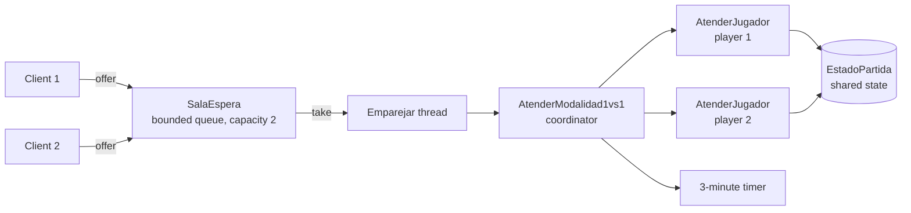

<p align="center"></p>

<p align="center">A multithreaded word puzzle server written in plain Java on top of raw sockets, playable from a TCP console client or from the browser through a hand-written HTTP server.</p>

<p align="center">
  
  <a href="LICENSE"></a>
  <a href="https://santiagodie.github.io/wordhive-socket-server/"></a>
</p>

## Table of Contents

- [About the Project](#about-the-project)
- [Live Demo](#live-demo)
- [Features](#features)
- [Built With](#built-with)
- [How It Works](#how-it-works)
- [Getting Started](#getting-started)
- [Project Structure](#project-structure)
- [Known Limitations](#known-limitations)
- [Credits](#credits)
- [License](#license)
- [Contact](#contact)

## About the Project

WordHive is a daily word puzzle inspired by PalabReto: each day offers seven letters, one of which is the central letter, and players score points by finding valid words built only from those letters. The project explores how the same game logic behaves over two very different transports: a persistent TCP connection with a custom text protocol, which supports a real-time 1v1 mode, and stateless HTTP requests served by a minimal web server built directly on `ServerSocket`.

No frameworks or external libraries are used beyond JAXB for reading the puzzle data. In-game messages are in Spanish.

## Live Demo

**[santiagodie.github.io/wordhive-socket-server](https://santiagodie.github.io/wordhive-socket-server/)**: a static build of the web client only (UI in Spanish) that runs entirely in the browser, validating words locally with the same rules as the server. It is in Spanish because WordHive is a Spanish word game (the letters and the dictionary are Spanish) and the original project was developed in Spanish. The console mode and the real 1v1 over TCP require running the Java server (see [Getting Started](#getting-started)).

## Features

- **Two deployment modes from a single entry point**: at startup the server asks whether to run as a TCP console server (port 7777) or as an HTTP web server (port 7070).
- **Normal mode** (console and web): single player, no time limit.
- **1v1 mode** (console): two clients are matched automatically through waiting rooms and play the same puzzle for 3 minutes, after a 3-second countdown. Leaving or disconnecting counts as a surrender and the opponent wins.
- **Word validation**: a word is accepted if it has at least 3 letters, contains the central letter, uses only the day's letters, appears in the day's word list and has not already been played.
- **Scoring**: 3 letters = 1 point, 4 letters = 2 points, 5+ letters = 1 point per letter. A word that uses all seven letters scores 10 + its length.
- **Daily puzzles**: 31 puzzles stored as XML and loaded with JAXB; the server picks the one matching the current day of the month.
- **Web client**: HTML/CSS/JavaScript pages served by the same Java server, talking to it through `fetch` and a small JSON API.

## Built With

- Java SE (source level 1.8), `java.net` sockets
- `java.util.concurrent`: `ExecutorService`, `ConcurrentHashMap`, `LinkedBlockingQueue`, `CountDownLatch`, `Future`
- JAXB for XML deserialization
- HTML, CSS and vanilla JavaScript for the browser client

## How It Works

**Console (TCP).** The connection stays open for the whole session. The server drives the dialogue with three control lines: `<CLIENT_LISTEN>` (client only prints), `<CLIENT_TALK>` (client may send input) and `<CLIENT_EXITCODE>` (client wants to leave; sent when the user types `exit now`).

For 1v1, each client socket is offered to a `SalaEspera`, a bounded queue of capacity 2. A dedicated `Emparejar` thread per room blocks on `take()` until two players are waiting, then starts an `AtenderModalidad1vs1` coordinator. The coordinator runs one `AtenderJugador` task per socket plus a 3-minute timer, and both players share one `EstadoPartida` object: scores are updated under a lock, the "game active" flag is `volatile`, and a `CountDownLatch(2)` lets the coordinator wait until both players have finished before cancelling the timer.



**Web (HTTP).** Each request is handled on its own socket, which is closed after the response. The handler parses the request line and `Content-Length` body by hand, serves static files with the right MIME type, and exposes:

| Method | Path | Purpose |
| --- | --- | --- |
| `GET` | `/letras` | Today's letters and central letter as JSON |
| `POST` | `/validar` | Validate a word (`{"palabra": "..."}`) and return the result and points as JSON |
| `POST`/`GET` | `/1vs1/join`, `/1vs1/estado`, `/1vs1/validar`, `/1vs1/rendirse` | Experimental web 1v1 backend (see [Known Limitations](#known-limitations)) |

Because HTTP is stateless, the server validates each word on its own; the browser keeps track of the running score and the words already played.

## Getting Started

### Prerequisites

The code uses `javax.xml.bind` (JAXB), which was removed from the JDK in Java 11. Either:

- **JDK 8**, which still bundles JAXB, or
- **JDK 11 or later** plus the JAXB jars on the classpath (steps below).

All commands must be run **from the repository root**: the server loads `src/xml/Dias/` and `src/servidor/web/statics/` through paths relative to the working directory. The commands below use a POSIX shell (Linux, macOS, or Git Bash on Windows).

### Installation

**With JDK 11+.** Download the JAXB jars into `lib/` (ignored by Git):

```bash
mkdir -p lib
curl -L -o lib/jaxb-api-2.3.1.jar https://repo1.maven.org/maven2/javax/xml/bind/jaxb-api/2.3.1/jaxb-api-2.3.1.jar
curl -L -o lib/jaxb-impl-2.3.9.jar https://repo1.maven.org/maven2/com/sun/xml/bind/jaxb-impl/2.3.9/jaxb-impl-2.3.9.jar
curl -L -o lib/javax.activation-api-1.2.0.jar https://repo1.maven.org/maven2/javax/activation/javax.activation-api/1.2.0/javax.activation-api-1.2.0.jar
```

Compile and start the server:

```bash
javac -encoding UTF-8 -cp "lib/*" -d out $(find src -name "*.java")
java -cp "out:lib/*" servidor.Servidor      # on Windows (Git Bash): -cp "out;lib/*"
```

**With JDK 8:**

```bash
javac -encoding UTF-8 -d out $(find src -name "*.java")
java -cp out servidor.Servidor
```

### Usage

When the server starts it asks for a deployment mode:

- **`1` - Web**: open `http://localhost:7070` and choose a mode from the home page.
- **`2` - Console**: in one or more additional terminals, start a client:

  ```bash
  java -cp out cliente.Cliente
  ```

  Pick `1` for normal mode or `2` for 1v1 (start two clients choosing `2` to get matched). Type `exit now` to leave.

Only one mode runs per server instance; restart the server to switch.

## Project Structure

```
src/
├── servidor/
│   ├── Servidor.java              # Entry point: chooses TCP (7777) or HTTP (7070), dispatches sockets to a thread pool
│   ├── AtenderConexion.java       # Console session: mode selection menu
│   ├── AtenderModalidadNormal.java
│   ├── modalidad1v1/              # Console 1v1: matchmaking thread, match coordinator, per-player handler
│   └── web/                       # HTTP request handler, experimental web 1v1 backend, static files (statics/)
├── cliente/Cliente.java           # Console client
├── modeloDominio/                 # Player, shared match state, waiting rooms
├── utils/                         # Game rules and scoring, HTTP helpers, JAXB (de)serialization
└── xml/                           # JAXB-mapped classes and the daily puzzles (Dias/Dia1.xml ... Dia31.xml)
demo/                              # Static web demo published to GitHub Pages
```

## Known Limitations

- **Web 1v1 is not finished.** The `/1vs1/*` backend exists but does not work reliably, since stateless requests are not tied to a player session. The browser page therefore simulates the opponent locally (random points at random intervals); only the player's own words are validated by the server.
- **Console 1v1 may never end on time on machines with 4 or fewer cores.** The thread pool is sized to the number of available processors, and a single match occupies four pool threads at once (coordinator, two players and the timer). With 4 or fewer cores the timer task can stay queued, so the 3-minute limit is never enforced.

## Credits

Third-party UI components used in the web client:

- Animated card: [UIverse](https://uiverse.io/alexruix/heavy-elephant-39) by Alex Ruiz
- Play buttons: [UIverse](https://uiverse.io/CashOnlySeb/mighty-husky-81) by CashOnlySeb
- 3D NEXBOT: [Spline Community](https://app.spline.design/community/file/615b9422-9985-43f6-8593-d7d7bc3b0be1) by aximoris
- Home button: [UIverse](https://uiverse.io/portseif/popular-octopus-83) by portseif
- Letter buttons: [UIverse](https://uiverse.io/levxyca/tidy-mayfly-7) by levxyca
- Validate button: [UIverse](https://uiverse.io/TISEPSE/ugly-badger-82) by TISEPSE
- Loader: [UIverse](https://uiverse.io/andrew-manzyk/unlucky-mouse-21) by Andrew Manzyk

## License

Released under the [MIT License](LICENSE).

## Contact

Santiago Die · [GitHub](https://github.com/santiagodie) · [LinkedIn](https://www.linkedin.com/in/santiago-die-morejon)

---

Built for the Distributed Systems course at the University of La Rioja (2025–26).
